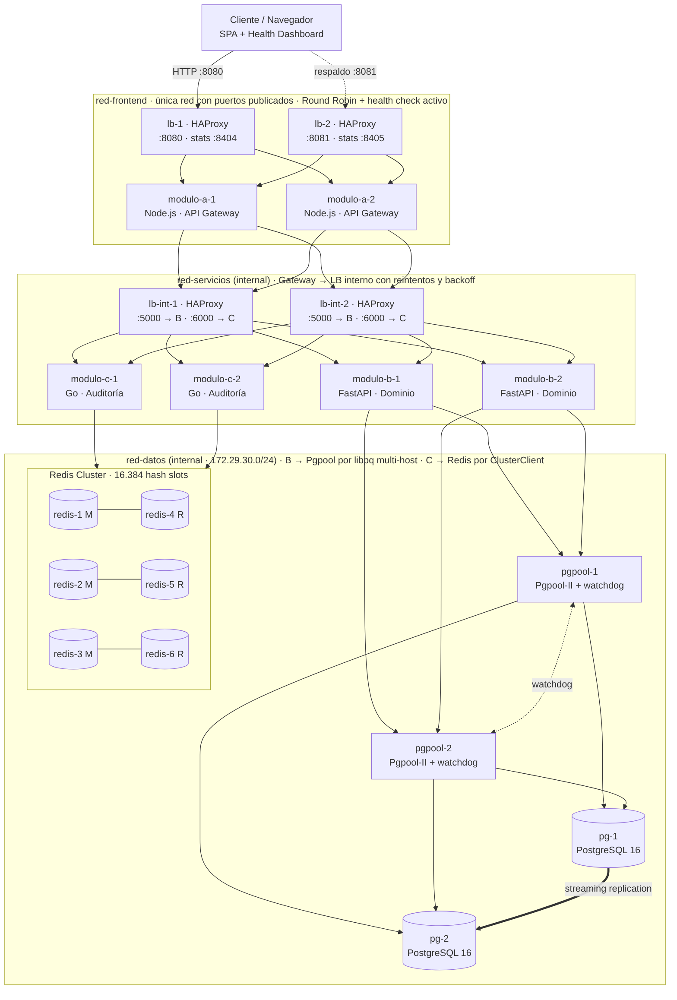
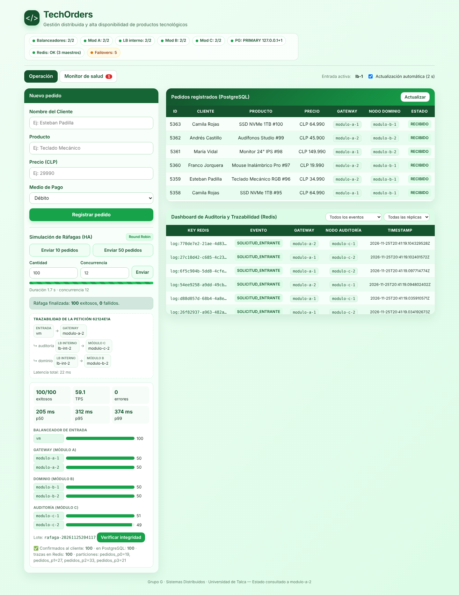
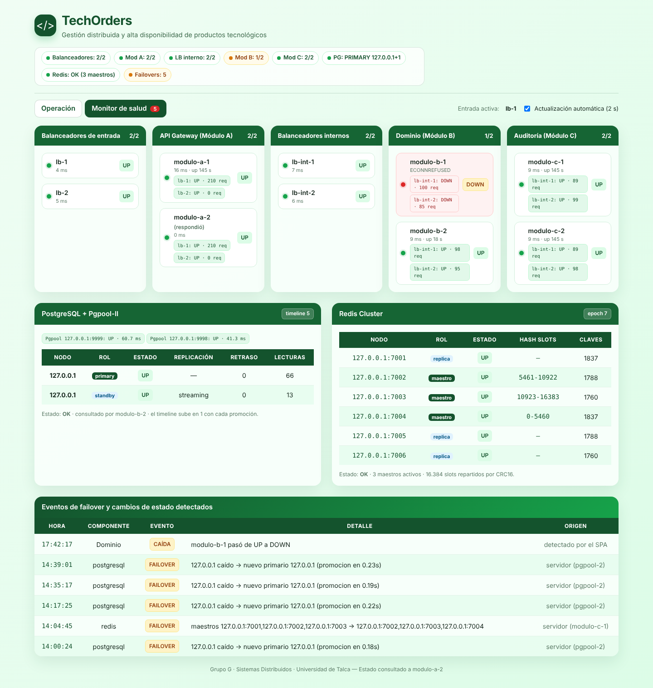

# TechOrders — Proyecto Sistemas Distribuidos (Unidad 3)

Plataforma políglota de pedidos (Node.js · Python/FastAPI · Go) evolucionada hacia **alta disponibilidad, tolerancia a fallos y escalabilidad**: sin puntos únicos de falla, tres redes segmentadas, balanceo con health checks activos, failover automático de PostgreSQL y Redis, particionamiento de datos, pruebas de caos/estrés y una interfaz SPA con monitoreo en tiempo real.

Grupo G — Juan Guzmán, Alonso Cabello, Cristóbal Vidal · Universidad de Talca



## Componentes (21 contenedores)

| Capa | Contenedores | Tecnología |
|---|---|---|
| Entrada | `lb-1` (:8080), `lb-2` (:8081) | HAProxy 3.0 — Round Robin + health check activo |
| Gateway | `modulo-a-1`, `modulo-a-2` | Node.js / Express — reintentos con backoff, trazabilidad, SPA |
| Balanceo interno | `lb-int-1`, `lb-int-2` | HAProxy 3.0 (:5000 → B, :6000 → C) |
| Dominio | `modulo-b-1`, `modulo-b-2` | Python / FastAPI — idempotencia, pool de conexiones |
| Auditoría | `modulo-c-1`, `modulo-c-2` | Go — cliente Redis Cluster |
| BD relacional | `pg-1`, `pg-2`, `pgpool-1`, `pgpool-2` | PostgreSQL 16 (streaming replication, particionado HASH) + Pgpool-II con watchdog |
| BD clave-valor | `redis-1` … `redis-6` (+ `redis-cluster-init`) | Redis 7.4 Cluster (3 maestros + 3 réplicas, 16.384 slots) |

## Levantar el sistema

Requisitos: Docker Desktop con al menos **4 CPU y 6 GB de RAM** asignados.

```powershell
docker compose up -d --build
docker compose ps            # esperar a que todo esté "healthy" (≈ 1 min la primera vez)
```

- Interfaz: **http://localhost:8080** (respaldo: http://localhost:8081)
- Estadísticas de los balanceadores: http://localhost:8404/stats y http://localhost:8405/stats
- Reiniciar desde cero (borra los datos): `docker compose down -v`

> Si se clonó en Windows antes de existir `.gitattributes` y algún contenedor falla con `/bin/bash^M`, ejecutar `git rm --cached -r . ; git reset --hard` para normalizar los fines de línea.

## Interfaz

| Operación | Monitor de salud con una réplica caída |
|---|---|
|  |  |

- **Nuevo pedido** con la traza completa de la petición (balanceador → gateway → réplica de C → réplica de B).
- **Simulación de ráfagas**: N pedidos con concurrencia C; muestra TPS, p50/p95/p99, reparto por réplica y verificación de integridad.
- **Tablas** de pedidos (PostgreSQL) y auditoría (Redis) con el nodo que atendió cada transacción y filtro por réplica.
- **Monitor de salud**: estado de cada nodo, vista de los health checks de HAProxy, nodos PostgreSQL (rol, replicación, timeline), Redis Cluster (rol, slots, claves) y eventos de failover.

*(Las capturas se tomaron en el laboratorio local de validación; en Docker los nombres aparecen como `lb-1`, `pg-1`, `172.29.30.x`.)*

## API

| Método | Ruta | Descripción |
|---|---|---|
| POST | `/api/pedidos` | Crea un pedido. Acepta `Idempotency-Key`. Devuelve `trazabilidad` por fase |
| GET | `/api/pedidos?limit=50` | Últimos pedidos (lectura balanceada por Pgpool) |
| GET | `/api/auditoria?limit=50&evento=` | Últimas trazas de auditoría |
| GET | `/api/cluster-status` | Estado de todas las capas y eventos de failover |
| GET | `/api/integridad?lote=X` | Pedidos en PostgreSQL vs trazas en Redis para un lote de prueba |
| GET | `/health` | Liveness de cada servicio |

Contratos completos en [docs/ACTUALIZACION_DOCUMENTO_DISENO.md](docs/ACTUALIZACION_DOCUMENTO_DISENO.md#5-contratos-de-interfaces-actualizados).

## Pruebas de resiliencia, caos y estrés

Plan completo: [docs/PLAN_DE_PRUEBAS.md](docs/PLAN_DE_PRUEBAS.md). Los resultados quedan en `resultados/`.

```powershell
# Escenarios automatizados (PowerShell 5.1 o 7)
.\pruebas\caos\escenario1-caida-nodos.ps1     # kill de réplicas A/B/C, primario PG y maestro Redis
.\pruebas\caos\escenario2-red.ps1             # latencia, pérdida de paquetes y particiones
.\pruebas\caos\escenario3-sobrecarga.ps1      # rampa de escrituras hasta 400 pedidos/s
.\pruebas\caos\escenario4-usuarios.ps1        # rampa hasta 300 usuarios (lecturas + escrituras)

# Análisis
python pruebas\analisis\rto.py resultados\sonda-<lote>-sonda.csv resultados\eventos-<lote>.log
python pruebas\analisis\por_etapa.py resultados\k6-<lote>.csv
```

Inyección manual de fallos:

```powershell
. .\pruebas\caos\caos.ps1
Get-PoolNodes                       # nodos PostgreSQL vistos por Pgpool
Matar-PrimarioPG                    # docker kill del primario actual
Matar-MaestroRedis
Matar-Contenedor modulo-b-1 ; Iniciar-Contenedor modulo-b-1
Agregar-Latencia modulo-b-1 -Ms 300 -PerdidaPct 10 ; Quitar-Latencia modulo-b-1
Desconectar-Red pg-1 red-datos ; Conectar-Red pg-1 red-datos
```

Herramientas sueltas:

```powershell
docker compose --profile pruebas run --rm -e LOTE=prueba1 k6 run /scripts/e1-caida-nodos.js
docker compose --profile pruebas run --rm -e DURACION_S=60 sonda
```

## Estructura

```
docker-compose.yml          topología completa (3 redes, 21 servicios + herramientas de prueba)
infra/haproxy/              balanceadores de entrada e internos
infra/postgres/             imagen PostgreSQL con arranque HA (rol automático y reincorporación) y esquema particionado
infra/pgpool/               imagen Pgpool-II, configuración con watchdog y script de failover
infra/redis/                configuración del clúster y script de inicialización
modulo-a/                   API Gateway + SPA (public/)
modulo-b/                   servicio de dominio
modulo-c/                   servicio de auditoría
pruebas/k6/                 escenarios de carga
pruebas/sonda/              sonda de disponibilidad (RTO)
pruebas/caos/               inyección de fallos y orquestación de escenarios (PowerShell)
pruebas/analisis/           tablas de RTO y de capacidad por etapa
docs/                       plan de pruebas, actualización del diseño, diagramas y capturas
```
